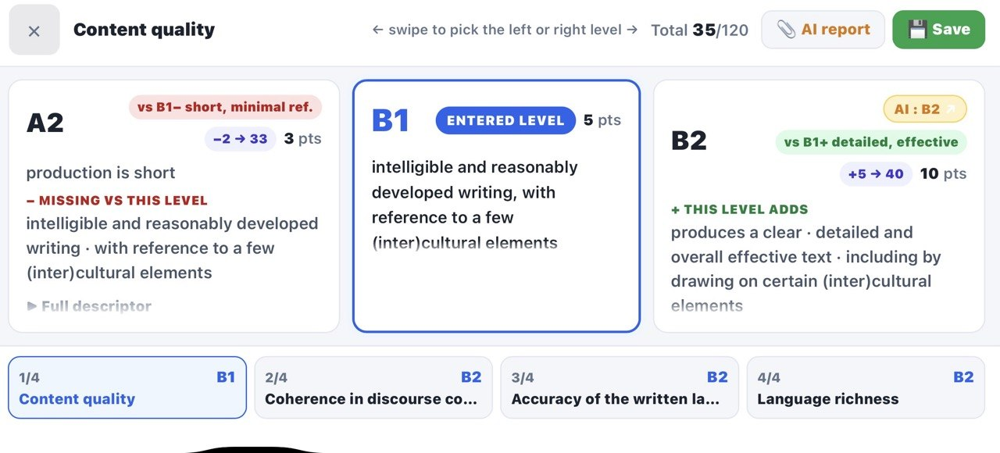
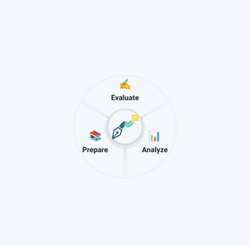
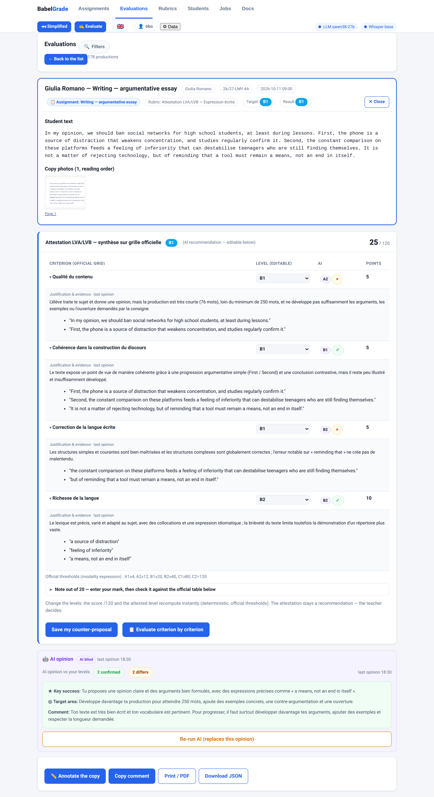
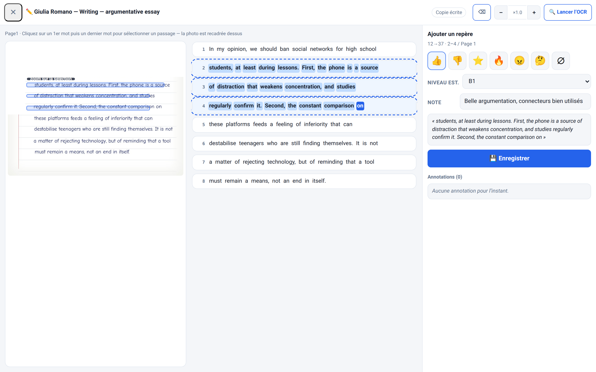

# BabelGrade

<p align="center">
  
</p>

<p align="center">
  <a href="https://github.com/lemeur/BabelGrade/actions/workflows/ci.yml"></a>
  <a href="requirements.txt"></a>
  <a href="LICENSE"></a>
</p>

> **BabelGrade is an agentic, fully local AI assessment tool.** A student's
> handwritten copy or oral recording flows through a pipeline of cooperating
> **local AI agents** — a vision model that reads the handwriting, an offline
> speech model that transcribes the recording, and a 27B language model that
> grades the work — and *every* one of them runs on a local machine.
> **No external API, no student data leaving the teacher's
> environment.**

<p align="center">
  
</p>
<p align="center">
  Screenshot of the mobile Criterion-by-criterion interface:
  each level card shows the AI's opinion, the entered level, and the /120 score
  recomputes as you swipe between levels
</p>

**Turn a student's written copy or oral recording into a CEFR attestation with
verbatim evidence.** BabelGrade is a teacher-facing, **international** web app
that maps every criterion of a CEFR attestation grid to a recommended level
(A1–C2) — and shows *why*: each recommendation is backed by verbatim quotes
(or timestamps) from the student's own work. It ships with the official
**French LVA/LVB** attestation grids as presets (the app's only France-specific
part — see [Custom rubrics](#custom-rubrics)), but the framework, the UI and
the whole workflow are language-neutral: the UI is localised in
**EN / FR / ES / DE**, and any grid can be defined as a custom rubric.

It is an objective **evidence extractor**: it lowers the teacher's cognitive
load, never replaces their judgment. Nothing is auto-graded — every level
stays editable and recomputes instantly.

> **One-pager (FR)** — a single A4 page explaining BabelGrade in French:
> [interactive HTML](docs/onepager-fr/onepager.html) ·
> [PDF](docs/onepager-fr/onepager.pdf).

## Local AI — the default, not the compromise

Student work — a handwritten essay, a recorded oral exam — is **personal
data**. A *sovereign* AI provider — one that respects students' data and is
validated by the French Ministry of National Education — would be permitted
to process it. But for development and fast experimentation, the simplest
way to guarantee that a minor's production never leaves the teacher's
environment is to run every AI step on the teacher's own machine. That is
what BabelGrade does, and why it is built around a pipeline of *local* AI
agents:

```
student work                  (all local — nothing leaves the teacher's machine)
  ┌───────────────────┐            ┌───────────────────────┐ Qwen3.8-27B
  │    written copy   │ photos────►│   OCR agent (vision)  │ (SGLang, local)
  │   (handwritten)   │            │  reads copy verbatim  │
  └───────────────────┘            │   → transcript text   │
  ┌───────────────────┐            ┌───────────┴───────────┐
  │   oral recording  │  audio────►│  ASR agent (offline)  │ faster-whisper
  │    (audio file)   │            │  transcript + timing  │ (base, int8, CPU)
  └───────────────────┘            │    fluency metrics    │
                                   └───────────┬───────────┘
                                               ▼
                                   ┌───────────────────────┐ Qwen3.8-27B (local)
                                   │    LLM grader agent   │
                                   │ rubric → Proof Matrix │
                                   └───────────────────────┘
```

Three cooperating agents, one machine:

| Agent | Model | Role | Runs |
|---|---|---|---|
| **OCR / vision** | Qwen3.8-27B (NVFP4, SGLang) | reads handwritten copies line by line, verbatim, with per-line boxes | local GPU |
| **ASR** | faster-whisper `base` (int8) | transcribes oral audio + word timings | local CPU, fully offline |
| **Grader / language** | Qwen3.8-27B | grades against the CEFR rubric, produces the Proof Matrix | local GPU |

The LLM *cannot hear audio* — the two channels deliberately stay separate:
audio goes through the ASR agent first, the model only ever sees the
timestamped transcript. No component phones home; the app runs offline once
the models are cached.

---

## What it does

1. **Analyze a submission** — paste the student's text *and/or* attach photos
   of the copy (the vision model reads them directly — no OCR copy-paste),
   or drop an oral audio recording. Optionally attach the task instruction
   and/or the source document (text, photos, PDF, or audio).
2. **Get a Proof Matrix** — every rubric criterion gets a suggested CEFR
   level, a justification, and verbatim evidence. No level without a quote.
3. **Attestation synthesis** — on the official attestation grids (LVA/LVB
   presets), per-criterion levels (A1–C2) are converted to a deterministic
   **score /120** and an attestation level, recomputed live as the teacher
   edits.
4. **Annotate the copy** — select a word range in the OCR'd transcript: the
   photo auto-crops to it, the teacher drops a marker (sticker, level, note)
   that the AI reads as context for its next run.
5. **Annotate the oral** — the transcript is word-timestamped; select a range,
   the player seeks to it, and markers carry time ranges.
6. **Dual AI loop** — "AI first" (grade from the AI report) or "teacher
   first" (grade yourself, then ask the AI for a blind or *aware* second
   opinion that confirms or refutes each criterion with evidence).
7. **Roster photo import** — import a class + its students from roster
   photos, with a review step before anything is committed.

### Screenshots

<p align="center">
  
</p>

<p align="center">
  Quick access to all functions from a simple home radial menu
</p>

<details>
<summary><b>AI analysis report</b> — Proof Matrix with justifications + verbatim evidence, AI column (✓/≠), attestation /120, AI feedback card</summary>



</details>

<details>
<summary><b>Written copy annotation</b> — photo ↔ OCR dual pane, word-range selection with auto-crop, marker panel (sticker · level · note)</summary>



</details>

<details>
<summary><b>Oral annotation</b> — synced audio player + timestamped transcript, range selection, marker panel</summary>


</details>

---

## How it works

- **Backend** — FastAPI (`app/`), SQLite persistence (`data/babelgrade.db`).
  Multi-user: PBKDF2 logins, every owned table scoped to its owner.
- **LLM** — a local OpenAI-compatible endpoint (by default SGLang serving
  `qwen38-27b`, text + vision). The model *cannot hear audio*; oral
  submissions go through offline **faster-whisper** first (timestamped
  transcript + word timings), and fluency metrics (WPM, pauses, hesitation
  tokens) are computed deterministically from the ASR timings.
- **Async job queue** — long LLM/Whisper work is offloaded to an in-process
  background scheduler (`app/jobs.py`, no external broker). The queue
  survives restarts; progress streams over SSE. Because the work is
  organised as **asynchronous, persistent jobs** with a stable handle-and-SSE
  contract, the system is built to scale out: the same tasks can be
  distributed across remote systems (additional inference machines) without
  changing the API or the UI. See
  [docs/async-jobs.md](docs/async-jobs.md).
- **Frontend** — a single vanilla-JS page (`static/index.html`), localised
  in **EN / FR / ES / DE**, with a simplified "home" mode driven by an
  animated radial menu.

## Custom rubrics

BabelGrade works with **any** CEFR rubric, not only the French presets:

- **Presets (shared):** the official French LVA/LVB attestation grids
  (comprehension, written expression, oral expression) are bundled as
  shared rubrics with the official A1→C2 criterion descriptors, the
  deterministic /120 scoring and the attestation thresholds. They ship
  in their original French wording — that is data, not UI: every screen
  around them is in the language the teacher has chosen.
- **Custom rubrics (per owner):** teachers can create their own rubric with
  any criteria, any level scale and any wording, in whatever language they
  prefer. A custom rubric is private to its owner and can be used on any
  assignment, in any of the four UI languages.

## Roadmap — where the agentic loop goes next

The core loop (OCR/ASR → grader → Proof Matrix) already works end-to-end on
local models. The remaining work is about making each agent *smarter* and
closing the loop from assessment back to the learner. Priorities:

1. **Harden the OCR / ASR agents — faithful, not "correct".** Improve the
   transcription and handwriting-reading workflows so they stay *verbatim*:
   they must adapt to imperfect audio and imperfect cursive writing
   (blue grid paper, smudges, crossed-out words) **without correcting the
   student's own errors.** A student's mistakes are the signal the grader
   reads; a "cleaned-up" transcript would silently destroy it.
2. **Relevant feedback for the learner.** Improve the analysis so each
   student gets actionable feedback — key strengths, target areas, and
   *concrete improvement suggestions and practice exercises* tied to the weak
   criteria. Sharing will be via a **secure link / QR code**, so a teacher can
   hand a report straight to a student **without creating an app account**.
3. **Per-student progression for the teacher.** Aggregate an individual's
   results across *all* evaluations to profile their skills over time, then
   **propose and track a personalised progression plan** and share it. This
   directly supports preparing **class councils / report periods**.
4. **Class-level insight.** Aggregate a whole group's results to give the
   teacher a read on the **class's overall level and heterogeneity** — what
   worked, what to re-teach, who to watch.

These are deliberately *agentic* upgrades: better prompts, better evidence
handling, and multi-agent reasoning on top of the same local models.

**Deployment today, and beyond.** Teachers correct their students' work on
their own machine, at home — BabelGrade is designed for that: one local
install, the AI pipeline on the teacher's hardware, and the async job
layer ready for tasks to be fanned out to additional (remote) inference
systems when the class grows. If the tool proves itself, a hosted deployment
*within the Ministry of National Education* is a realistic next step — the
same data-protection guarantees, at ministry scale, without every teacher
running their own GPU.

## Quick start

```bash
pip install -r requirements.txt
./run.sh                 # http://<host>:8090
HOST=0.0.0.0 PORT=8090 ./run.sh
```

Configuration (env vars, all optional):

| Variable | Default | Purpose |
|---|---|---|
| `BABELGRADE_LLM_BASE` | `http://127.0.0.1:8078/v1` | OpenAI-compatible LLM endpoint |
| `BABELGRADE_LLM_MODEL` | `qwen38-27b` | Model name |
| `BABELGRADE_LLM_API_KEY` | *(empty)* | API key |
| `BABELGRADE_INITIAL_LOGIN` | `tibo` | first-boot account (registration stays open only for this) |
| `BABELGRADE_INITIAL_PASSWORD` | *(empty)* | first-boot password |
| `BABELGRADE_DB_PATH` | `data/babelgrade.db` | SQLite path (tests use a throwaway DB) |
| `BABELGRADE_WHISPER_CACHE` | `~/.cache/huggingface/hub` | faster-whisper model cache (`download_root`) |

Requires Python 3.11+, uvicorn, faster-whisper, PyMuPDF. The Whisper model is
cached locally and the app runs fully offline (all Hugging Face downloads are
disabled at import time). The LLM endpoint must be reachable — BabelGrade has
no LLM fallback.

## Security model

- **Multi-user, per-owner scoping.** PBKDF2-HMAC-SHA256 (per-user salt +
  application pepper) password hashes; session cookie auth. Every owned
  table (students, assignments, submissions, analyses, annotations, jobs,
  custom rubrics) is scoped to its owner on every read and write, enforced
  by a FastAPI dependency that injects the current owner.
- **Media ownership.** `/api/files` serves a file *only* to its owner;
  foreign, unknown, and untracked files all 404 identically so no filename
  enumeration is possible.
- **Registration is closed by default.** Accounts can only be registered at
  first boot (via the initial-login env vars); the app refuses to stay in
  "registration open" afterwards.
- **Nothing leaves the teacher's environment.** No external API calls at all
  in the local deployment: the LLM is a local OpenAI-compatible endpoint and
  the ASR model runs offline.
- **Evidence before level.** The backend warns when a criterion mapping
  lacks a verbatim quote; recurring errors are flagged, isolated slips are
  not over-penalised; per-student accommodations may change content and
  feedback but never the demonstrated level.

## Testing

The suite is split into two classes:

**Hermetic, in-process suites** (throwaway SQLite DB, in-process OpenAI
mock server, no live server, no LLM, no Whisper model) — these run in CI
and can be run anywhere the dependencies install:

```bash
python tests/test_multiuser_smoke.py     # auth gate, owner scoping, isolation
python tests/test_media_ownership.py     # media-ownership 404 matrix
python tests/test_p2_mock_llm_e2e.py    # full job pipeline against a mocked LLM
python tests/test_roster_import.py      # roster photo import E2E (mocked LLM)
python tests/test_ui_language_prompt.py # prompt-builder unit checks
python tests/test_p0_state_i18n_js.py   # i18n 4-lang balance + node --check
python -m pytest tests/test_ocr_resnap.py -q   # OCR resnap alignment units
```

**Live Playwright suites** drive the real UI against a running server on
`127.0.0.1:8090` (they read the live-server credentials from
`tests/.credentials`, which is gitignored by design). See
[CONTRIBUTING.md](CONTRIBUTING.md#running-tests) for the local recipe.

CI: [`.github/workflows/ci.yml`](.github/workflows/ci.yml) runs ruff,
byte-compilation and every hermetic suite on Python 3.11 and 3.13.

## Repository layout

```
app/main.py            FastAPI factory + auth gate + include_router (no routes)
app/routes_*.py        route modules (auth, rubrics, students, assignments,
                       analyze, evaluate, jobs, analyses, annotate, files,
                       docs, admin, health, roster)
app/assess.py          prompts, fluency metrics, JSON parse/validate
app/llm_client.py      OpenAI-compatible client (stream + JSON extract)
app/whisper.py         offline faster-whisper wrapper (cached model)
app/db.py              SQLite + forward migration
app/stats.py           assignment + per-student stats
app/rubrics.py         LVA/LVB attestation presets + /20 conversion tables
app/auth.py            multi-user auth (PBKDF2, owner scoping)
app/jobs.py            async job queue (scheduler, workers, SSE)
app/media.py           upload staging + PDF/scan/doc-audio extraction
app/ocr.py             LLM-direct OCR for the annoter (per-line boxes 0..1000)
app/imaging.py         image enhancement for copy-photo OCR
app/config.py          paths + upload limits
static/index.html      single-page UI (EN/FR/ES/DE)
docs/                  user guide, architecture, async-jobs (in-app Docs view)
tests/                 hermetic + Playwright E2E suites, mock LLM server
scripts/               dev probes and screenshot generators
mockups/               standalone UI prototypes (radial menu, hybrid annoter)
.github/workflows/     CI (lint + hermetic suites, Python 3.11/3.13)
run.sh                 launcher
```

## Development

Short guide: see [CONTRIBUTING.md](CONTRIBUTING.md). Module map, import
direction rules and the "add an endpoint" recipe:
[docs/architecture.md](docs/architecture.md). Outstanding work: [TODO.md](TODO.md).

## Built with AI

> **This project is vibe-coded.** The codebase was produced by an LLM
> (Hermes Agent) working with **Qwen3.8-27b** — the same local model
> the app uses at runtime to assess student work. Feature design, UI
> iterations, OCR pipeline, and the whole E2E test suite were co-authored in
> conversation, with the app itself running on the same machine. It stands as
> a working example of a non-trivial, multi-user, production-shaped web app
> built conversationally on a local 27B model.

## License

[MIT](LICENSE) © 2026 BabelGrade contributors
