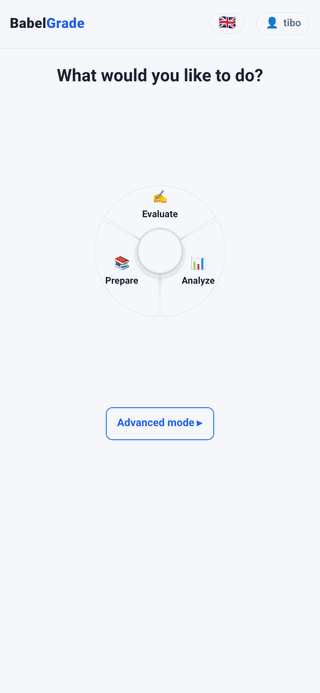
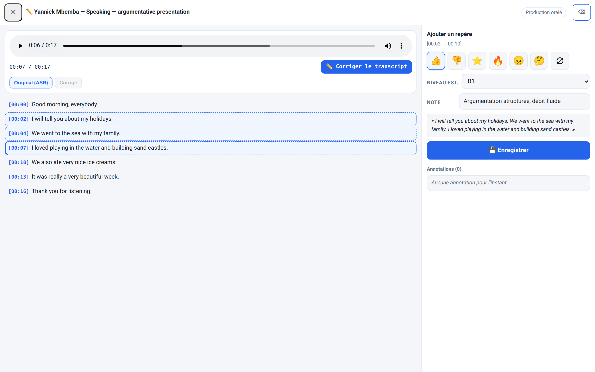

# BabelGrade

**Turn a student's written copy or oral recording into a CEFR attestation with
verbatim evidence.** BabelGrade is a teacher-facing web app that maps every
criterion of the official French LVA/LVB attestation grids to a recommended
CEFR level (A1–C2) — and shows *why*: each recommendation is backed by
verbatim quotes (or timestamps) from the student's own work.

It is an objective **evidence extractor**: it lowers the teacher's cognitive
load, never replaces their judgment. Nothing is auto-graded — every level
stays editable and recomputes instantly.

<p align="center">
  
  
</p>

<p align="center">
  Home: a single radial menu (tap a verb, fan out, pick) · Mobile: grade every
  criterion with a bottom-sheet level picker
</p>

---

## What it does

1. **Analyze a submission** — paste the student's text *and/or* attach photos
   of the copy (the vision model reads them directly — no OCR copy-paste),
   or drop an oral audio recording. Optionally attach the task instruction
   and/or the source document (text, photos, PDF, or audio).
2. **Get a Proof Matrix** — every rubric criterion gets a suggested CEFR
   level, a justification, and verbatim evidence. No level without a quote.
3. **Attestation synthesis** — for the official LVA/LVB grids, per-criterion
   levels (A1–C2) are converted to a deterministic **score /120** and an
   attestation level, recomputed live as the teacher edits.
4. **Annotate the copy** — select a word range in the OCR'd transcript: the
   photo auto-crops to it, the teacher drops a marker (sticker, level, note)
   that the AI reads as context for its next run.
5. **Annotate the oral** — the transcript is word-timestamped; select a range,
   the player seeks to it, and markers carry time ranges.
6. **Dual AI loop** — "AI first" (grade from the AI report) or "teacher
   first" (grade yourself, then ask the AI for a blind or *aware* second
   opinion that confirms or refutes each criterion with evidence).

### Screenshots

<details>
<summary><b>AI analysis report</b> — Proof Matrix with justifications + verbatim evidence, AI column (✓/≠), attestation /120, AI feedback card</summary>


</details>

<details>
<summary><b>Written copy annotation</b> — photo ↔ OCR dual pane, word-range selection with auto-crop, marker panel (sticker · level · note)</summary>


</details>

<details>
<summary><b>Oral annotation</b> — synced audio player + timestamped transcript, range selection, marker panel</summary>



</details>

---

## How it works

- **Backend** — FastAPI (`app/`), SQLite persistence (`data/babelgrade.db`).
  Multi-user: PBKDF2 logins, every owned table scoped to its owner.
- **LLM** — a local OpenAI-compatible endpoint (by default SGLang serving
  `qwen38-27b`, text + vision). The model *cannot hear audio*; oral
  submissions go through offline **faster-whisper** first (timestamped
  transcript + word timings), and fluency metrics (WPM, pauses, hesitation
  tokens) are computed deterministically from the ASR timings.
- **Async job queue** — long LLM/Whisper work is offloaded to an in-process
  background scheduler (`app/jobs.py`, no external broker). The queue
  survives restarts; progress streams over SSE. See
  [docs/async-jobs.md](docs/async-jobs.md).
- **Frontend** — a single vanilla-JS page (`static/index.html`), i18n in
  **FR / EN / ES / DE**, with a simplified "home" mode driven by an animated
  radial menu.

## Quick start

```bash
./run.sh                 # http://<host>:8090
HOST=0.0.0.0 PORT=8090 ./run.sh
```

Configuration (env vars, all optional):

| Variable | Default | Purpose |
|---|---|---|
| `BABELGRADE_LLM_BASE` | `http://127.0.0.1:8078/v1` | OpenAI-compatible LLM endpoint |
| `BABELGRADE_LLM_MODEL` | `qwen38-27b` | Model name |
| `BABELGRADE_LLM_API_KEY` | *(empty)* | API key |
| `BABELGRADE_INITIAL_LOGIN` | `tibo` | first-boot account (registration stays open only for this) |
| `BABELGRADE_INITIAL_PASSWORD` | *(empty)* | first-boot password |
| `BABELGRADE_DB_PATH` | `data/babelgrade.db` | SQLite path (tests use a throwaway DB) |

Requires Python 3.11+, uvicorn, faster-whisper, PyMuPDF. The Whisper model is
cached locally and runs fully offline.

## Safety rails

- No level is suggested without at least one verbatim quote / timestamp
  (the backend warns when a criterion mapping lacks evidence).
- All levels are *recommendations*; the attestation score/level are editable
  by the teacher and recompute instantly.
- Recurrent errors are flagged; isolated slips are not over-penalised.
- Per-student **accommodations** (e.g. "dyslexia: weight spelling lightly")
  affect content/feedback, never the demonstrated level — and the model must
  state which were applied.
- Reasoning budget is capped (`thinking_budget`) so the structured JSON reply
  is never truncated.

## Repository layout

```
app/main.py        FastAPI factory + auth gate + include_router (no routes)
app/routes_*.py    12 route modules
app/assess.py      prompts, fluency metrics, JSON parse/validate
app/llm_client.py  OpenAI-compatible client (stream + JSON extract)
app/whisper.py     offline faster-whisper wrapper (cached model)
app/db.py          SQLite + forward migration
app/stats.py       assignment + per-student stats
app/rubrics.py     LVA/LVB attestation presets + /20 conversion tables
app/auth.py        multi-user auth (PBKDF2, owner scoping)
app/jobs.py        async job queue (scheduler, workers, SSE)
app/media.py       upload staging + PDF/scan/doc-audio extraction
app/ocr.py         LLM-direct OCR for the annoter (per-line boxes 0..1000)
app/imaging.py     image enhancement for copy-photo OCR
app/config.py      paths + upload limits
static/index.html  single-page UI (FR/EN/ES/DE)
docs/              user guide, architecture, async-jobs (in-app Docs view)
tests/             Playwright + API E2E suites
run.sh             launcher
```

## Built with AI

> **This project is vibe-coded.** The codebase was produced by an LLM
> (Hermes Agent) working with **Qwen3.8-27b** — the same local SGLang model
> the app uses at runtime to assess student work. Feature design, UI
> iterations, OCR pipeline, and the whole E2E test suite were co-authored in
> conversation, with the app itself running on the same VM. It stands as a
> working example of a non-trivial, multi-user, production-shaped web app
> built conversationally on a local 27B model.

## License

[MIT](LICENSE) © 2026 BabelGrade contributors
