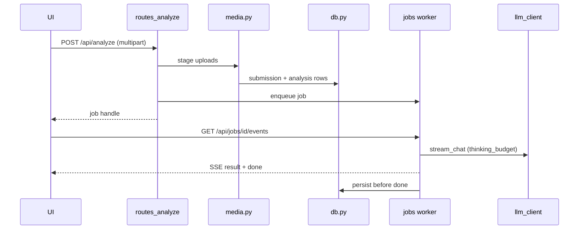

# Architecture — module map & conventions

One-page map of the codebase (2026-10-16 module split) so a new contributor —
or a future agent session — can navigate without re-discovering. Companion
docs: **Async jobs** (deep dive on the job queue) and the README (features).

## Module map

| File | Lines | Role |
| --- | --- | --- |
| `app/main.py` | 85 | `create_app()`: lifespan, global auth gate, CORS, DB init + seed, `include_router` ×12, static mounts. Wiring ONLY — no route handlers. |
| `app/routes_*.py` | 12 modules | One `APIRouter` per domain: health, auth, rubrics, students, assignments, admin, analyze, jobs, analyses, annotate, files, docs. |
| `app/db.py` | 1774 | SQLite layer: schema + forward-migrations (`init_db`), CRUD, owner scoping (`_owner()` contextvar read), media-ownership map. |
| `app/auth.py` | 233 | PBKDF2 logins, session table + HttpOnly cookie, `auth_dependency` gate, `owner_var` propagation. |
| `app/jobs.py` | 952 | Async job queue: `jobs` table (survives restarts), worker pool, `JobStream` SSE, the three long runners (analyze / evaluate / run-ai + stats-ai). |
| `app/media.py` | 512 | Upload validation/staging, PDF extraction (text layer / scanned-page JPEGs), doc-audio transcription, task-context + eval-notes assembly. |
| `app/assess.py` | 687 | Prompt building (system + task context + eval notes + accommodations + language), fluency metrics, LLM JSON parsing, matrix validation. |
| `app/rubrics.py` | 428 | Official LVA/LVB attestation grids + presets, `compute_attestation()`, /120 point scale, official /20 note bands (reference-only). |
| `app/stats.py` | 274 | `stats_for_assignment` (assignment stats view + stats-ai feed) and `stats_for_student` (per-student time chart). |
| `app/ocr.py` / `imaging.py` | 311 / 190 | Hybrid OCR (Tesseract line boxes + LLM polish) and geometry-preserving image enhancement for the Annoter. |
| `app/whisper.py` | 88 | Offline faster-whisper (base, int8, CPU) with word-level timings. |
| `app/llm_client.py` | 160 | SGLang OpenAI-compatible client: `chat_json` + `stream_chat` (honours `thinking_budget`). |
| `app/config.py` | 21 | Paths + upload limits (`UPLOAD_DIR`, `MAX_*_BYTES`…). Import from here, never re-define. |
| `app/docs_catalog.py` | 21 | Which markdown docs the in-app Docs view can render (slug → path + category). |
| `static/index.html` | ~7700 | The whole SPA: views, i18n (4 languages), hand-rolled charts, the doc-view markdown renderer + vendored mermaid. |

## Module structure

```mermaid
flowchart LR
  UI["static/index.html<br/>SPA · i18n x4 · charts"]
  MAIN["app/main.py<br/>factory · auth gate ·<br/>include_router x12"]
  subgraph RT["route modules — 12 APIRouters"]
    RA["analyze"]
    RJ["jobs"]
    RC["assignments"]
    RS["students"]
    RX["…+8 more"]
  end
  subgraph CORE["domain layer"]
    JOBS["jobs.py"]
    MEDIA["media.py"]
    ASSESS["assess.py"]
    STATS["stats.py"]
    RUB["rubrics.py"]
  end
  subgraph IO["I/O + data"]
    LLM["llm_client.py"]
    WH["whisper.py"]
    OCR["ocr.py + imaging.py"]
    DB["db.py"]
    AU["auth.py"]
  end
  UI --> MAIN
  MAIN --> RT
  RT --> CORE
  CORE --> IO
```

Import direction is one-way and layered: `db <- {stats, media, jobs, …} <-
routes <- main` (the UI talks to `main` only, via `/api/*`). Never create the
reverse — e.g. a `db.py` re-export of the `stats.py` names would make
`db <-> stats` circular (hit in P2.7). The table above carries the
per-module "calls which" detail; the diagram carries the layering.

## Long-endpoint request lifecycle

The three heavy endpoints (`POST /api/analyze`, `POST /api/evaluate`,
`POST /api/analyses/{id}/run-ai`) are **async**: the request stages uploads
fast, persists rows, enqueues a job and returns a job handle. Progress is
followed on `GET /api/jobs/{id}/events` (SSE: `meta` → `phase*` → `token*` →
`result` → `done|error|cancelled`). Full state machine + sequence detail:
the **Async jobs** doc.

## Conventions to preserve

- **Owner scoping** — every owned row carries `owner_id`; the request's
  identity rides in `auth.owner_var` (a contextvar) and `db._owner()` reads
  it. Job runners re-set it per job. New owned queries MUST filter by it
  (or use a `_scoped()` helper).
- **Proof-matrix rule** — every rubric criterion gets a mapping with at
  least one verbatim evidence item; `assess.validate_matrix()` warnings are
  surfaced in the UI. No level without a quote/timestamp.
- **Media ownership** — `/api/files` serves a file only to its owner
  (`db.media_owner_map()`); untracked files 404.
- **Last AI opinion wins** — `run-ai` overwrites `analyses.ai_matrix_json`
  on every run; `matrix_json` is the teacher's, never touched by the AI.
- **No per-element listeners inside a rendered report** — the history flow
  re-serialises `#hist-report` via innerHTML, which detaches them. All
  report interactivity is document-level delegation registered once at boot.
- **Never bind a local named `t`, `esc`, `stats`, `$` in a function that
  also needs the global of that name** — the i18n `t` shadowing cost a whole
  debugging session; `stats` is the module, so local vars are `data`/`agg`.
- **i18n** — every key exists in all 4 languages (en/fr/es/de); FR values
  use typographic apostrophes (') only; run the 4-way key-count check after
  any i18n edit.
- **DB schema** — forward-migrated at startup by `init_db` (idempotent
  `ALTER TABLE ADD COLUMN`); additive column changes need no manual
  migration.

## Recipes

### Add a new endpoint

1. Put it in the matching `app/routes_<domain>.py` on that module's
   `router` (create a new module + `include_router` in `main.py` only for a
   genuinely new domain).
2. Heavy work goes through a job (see Async jobs doc); light reads call
   `db.*` / `stats.*` directly.
3. Owned data → scope with `db._owner()`; uploads → `app/media.py` helpers.
4. UI: add the key(s) to all 4 i18n dicts + `node --check` the extracted JS.
5. Add/extend a test in `tests/` (in-process TestClient for API shape,
   Playwright for UI), commit, verify per the close-out checklist in
   `TODO.md`.

### Add a doc to the in-app Docs view

1. Write `docs/<name>.md` (minimal markdown: headings, tables, fenced code,
   lists, quotes; mermaid fences render via the vendored mermaid).
2. Add a slug to `DOCS_INDEX` in `app/docs_catalog.py` with its `category`
   (`user` or `dev`).
3. i18n: add `docs.tab.<slug>` in all 4 languages.
4. Frontend: the dev sub-tab labels come from an inline ternary in the docs
   view JS block (`paintDocsSubtabs`, `static/index.html`) that maps slugs
   to i18n keys — add your slug if its i18n key is not just the slug
   itself (`architecture` is the new case; `async-jobs`→`asyncjobs`).
5. Verify in the app: Docs → Dev section → new sub-tab renders, mermaid
   diagrams paint (check visually, not just "it parsed").

## Verification baseline

- `ruff check .` (100% green — `ruff.toml`: app/ strict, tests/ + scripts/
  relaxed) and `python3 -m py_compile app/*.py`.
- In-process suites (hermes venv, temp DB): `tests/test_multiuser_smoke.py`,
  `tests/test_media_ownership.py`, `tests/test_ui_language_prompt.py`.
- Playwright suites (`/tmp/elt_dm/venv`, live server on :8090, login
  `tibo`/`BABELGRADE_TEST_PASSWORD` (in `tests/.credentials`)): `tests/test_smoke_assignments.py`,
  `tests/test_p4_filters.py`, `tests/test_p5_filters.py`,
  `tests/test_p6_ststats.py`, `tests/test_p7_eval_exit.py`,
  `tests/test_ui_language_frontend.py`.
- Server health: `curl -s localhost:8090/api/health`.
