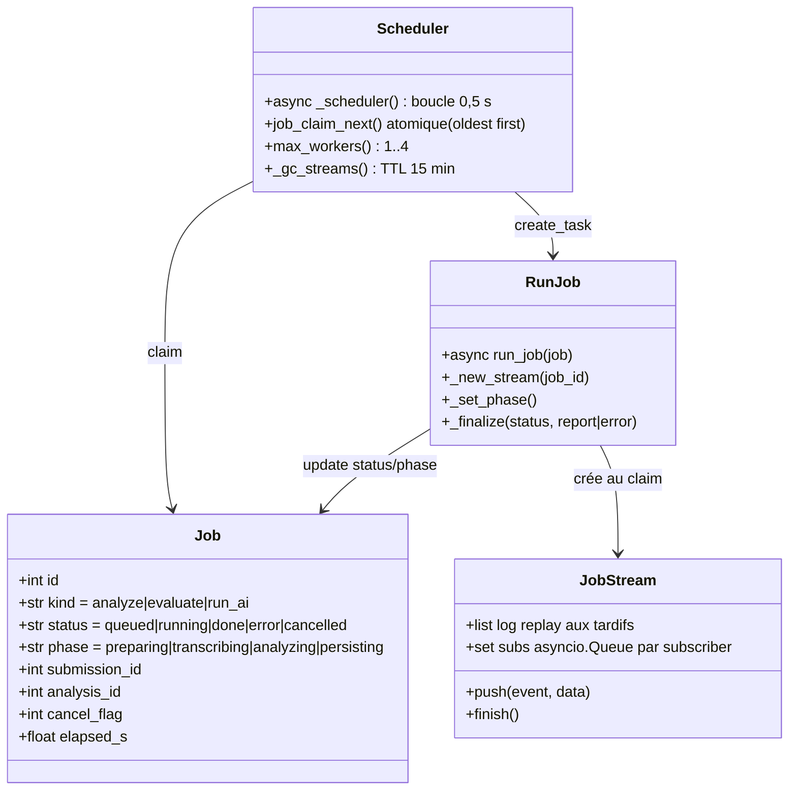
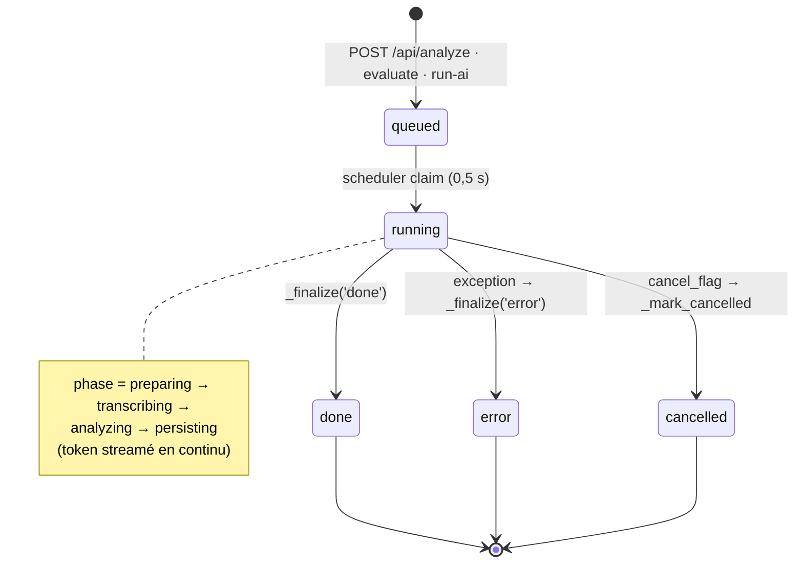
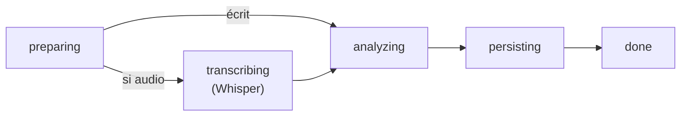
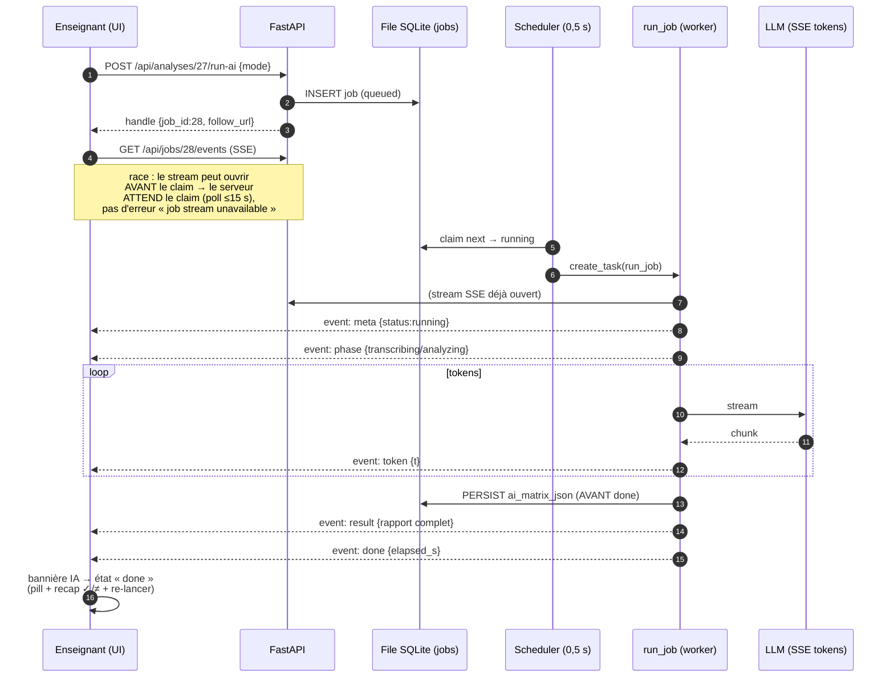
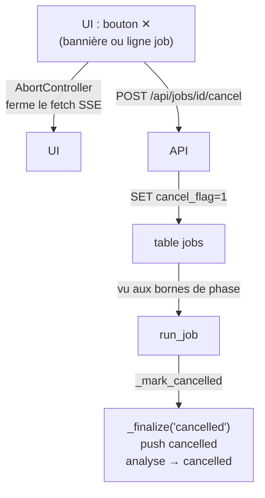

# Tâches asynchrones (job queue) — Architecture, états et flux

> BabelGrade · `app/jobs.py` + `app/main.py` + `static/index.html`
> Mise à jour : 2026-10-07 — feature **terminé + E2E-verified** (voir `references/async-jobs.md` du skill).

Les traitements longs (transcription Whisper, extraction de documents, analyse IA,
réanalyse IA) ne bloquent plus le thread de la requête HTTP : ils sont déportés
dans une **file de jobs en arrière-plan**, exécutée par un **scheduler asyncio
interne au serveur**. Ce document décrit l'architecture, les états et les flux,
avec schémas Mermaid et captures d'écran annotées.

---

## 1. Architecture

```mermaid
flowchart LR
    subgraph UI["Front-end (static/index.html)"]
        A1["POST /api/analyze<br/>POST /api/evaluate<br/>POST /api/analyses/id/run-ai"]
        A2["SSE : GET /api/jobs/id/events"]
        A3["POST /api/jobs/id/cancel"]
    end

    subgraph API["API FastAPI (app/main.py)"]
        B1["Endpoint long<br/>(endpoint handler)"]
        B2["_job_events<br/>(streaming SSE)"]
        B3["cancel endpoint"]
    end

    subgraph JOBS["Queue + workers (app/jobs.py)"]
        C1["Table SQLite<br/><b>jobs</b> (persistée)"]
        C2["_scheduler()<br/>(task asyncio,<br/>boucle 0,5 s)"]
        C3["run_job()<br/>(task par job)"]
        C4["JobStream<br/>(log d'événements + fan-out)"]
        C5["Recover_orphans()<br/>au boot"]
    end

    subgraph WORK["Travail réel (main.py / assess.py / whisper)"]
        D1["stage + LLM<br/>(streaming tokens)"]
    end

    A1 --> B1
    B1 -->|insert row<br/>status='queued' +<br/>retour handle| C1
    B1 -.->|follow_url| A2
    A2 --> B2
    B2 -->|subscribe / replay| C4
    C5 -->|re-queue running| C1
    C2 -->|claim next| C1
    C2 -->|create_task(run_job)| C3
    C3 --> C4
    C3 --> D1
    D1 -->|push meta/phase/<br/>token/result/done<br/>AVANT done| C4
    A3 --> B3 -->|cancel_flag=1| C1
    C3 -->|check cancel<br/>aux bornes de phase| C3
```

**Points clés :**

- **Pas de runner externe** (pas de worker séparé, pas de broker Redis/Celery).
  Le scheduler est une `asyncio.Task` du même processus uvicorn.
- **File persistée en SQLite** (table `jobs`) : survit aux restarts ; au boot,
  `recover_orphans()` remet en `queued` tout job resté `running` par un crash.
- **`max_workers`** : 1 par défaut, plafonné à 4, réglable à chaud via
  `POST /api/jobs/settings` (`{"max_workers": n}`) — le scheduler lit la valeur
  à chaque tour de boucle.

### Schéma des composants (vue code)



---

## 2. États d'un job

Un job vit dans **5 états**, plus un sous-état de phase quand il est `running`.



| État | Qui le met | Effet |
|---|---|---|
| `queued` | l'endpoint (insert) | attend le scheduler |
| `running` | `job_claim_next()` (atomique) | exécuté par `run_job` |
| `done` | `_finalize('done')` | résultat persisté **avant** l'événement `done` ; `elapsed_s` mesuré |
| `error` | exception dans `run_job` | `jobs.error` rempli ; l'analyse associée passe en `error` (`_fail_analysis`) |
| `cancelled` | `cancel_flag` vu aux bornes de phase | l'analyse associée passe en `cancelled` |

> **Garantie de cohérence** : le travail persiste sa sortie (ex. `ai_matrix_json`)
> **avant** d'émettre `done`. Une re-fetch du détail après le run-ai voit
> toujours l'avis — c'est ce que le test `pw_jobs.py` vérifie (mock de la
> re-fetch qui injecte `ai_matrix`).

### Sous-états `phase` (job `running`)



- `preparing` : staging (fichiers, contexte assignment…).
- `transcribing` : Whisper (écrit uniquement si audio fourni / oral).
- `analyzing` : appel LLM (streaming des tokens vers le `JobStream`).
- `persisting` : écriture DB + calcul attestation + payload rapport.

---

## 3. Flux — d'un clic à la bannière IA



### Ce que voit l'UI à chaque étape

| Événement SSE | UI |
|---|---|
| `meta` | porte le vrai timeline du job (`created_at`/`started_at`/`finished_at`/`elapsed_s`) → le chrono démarre au **départ réel** du job, pas au clic ; état « En cours » |
| `phase` | libellé de phase (Préparation / Transcription / Analyse IA / Enregistrement) |
| `token` | tokens qui défilent dans la bannière / la carte « travail » |
| `result` | **rapport complet** (`jobs._report_payload` : matrice + attestation + avis IA) → `renderReport` |
| `done` | fin : bannière → état **done**, toast « ✓ » |
| `cancelled` / `error` | bannière → état annulé / erreur, toast |

> Le `result` du **run-ai** est le rapport **entier** (pas seulement l'avis) :
> `rep.data` = matrice enseignant, `rep.ai_data` = avis IA. L'UI merge
> `LIVE_D.ai_data = rep.ai_data` (last opinion wins, la matrice enseignant
> n'est jamais écrasée).

---

## 4. Annulation



- L'annulation est **coopérative** : le worker vérifie `cancel_flag` aux bornes
  de phase (pas au milieu d'un appel LLM). Le fetch SSE est coupé côté client
  par `AbortController` en parallèle.

---

## 5. Robustesse (restart, crash, retard)

| Cas | Comportement |
|---|---|
| **Restart serveur** avec job `running` en DB | `recover_orphans()` (au boot, via `start_workers`) le repasse en `queued` → rejoué. |
| **Crash** en cours de job | idem : ligne restée `running` → re-queue au prochain boot. |
| **Retard du scheduler** (le stream SSE ouvre avant le claim) | `_job_events` **attend** le claim (poll 0,25 s × 60 ≈ 15 s) au lieu d'errer ; si le job finit pendant l'attente, repli sur le rebuild-from-DB. *(Bug de race corrigé 2026-10-07.)* |
| **Reconnect tardif** sur un job déjà fini | `JobStream` garde son log 15 min (`STREAM_TTL_S`) → replay ; sinon rebuild-from-DB (méta + result + terminal). |

---

## 6. Captures d'écran (annotées)

### 6.1 Vue « Tâches » — file de traitement, job en cours

``

| # | Élément | Endpoint / code |
|---|---|---|
| ① | Compteurs en direct `⏳ · ▶ · ✓` | `GET /api/jobs/counts` |
| ② | Sélecteur **max_workers** (1–4) | `POST /api/jobs/settings` |
| ③ | Ligne du job **en cours** : type · phase · durée · `Suivre` / `✕` | `GET /api/jobs?limit=100` + `data-jfollow` / `data-jcancel` |

> **Suivi d'un job terminé (2026-10-11) :** les lignes **terminées** portent aussi un
> bouton `▶` (`data-jfollow`) — re-suivre relecture le log mémoire (15 min) ou reconstruit
> l'état final depuis la BDD. La carte de suivi affiche : le **chrono depuis le départ réel**
> du job (pas le clic ; `meta` porte `created_at/started_at/finished_at/elapsed_s`), les
> **phases lisibles** (⚙️/🎧/🤖/💾 + heure locale) et, une fois le `result` reçu, un bouton
> **`Résultat (JSON)`** ouvrant la sortie complète du job (copie + téléchargement
> `elt-job-<id>.json`). La capture ci-dessus montre l'état *en cours* ; le bouton ▶ des
> lignes terminées est le même mécanisme.

### 6.2 Rapport squelette + bannière IA en état *picker* (flux « Évaluer d'abord »)

``

| # | Élément | Origine |
|---|---|---|
| ① | Rapport squelette (matrice vide, attestation 0/120) | job `evaluate` → événement `result` |
| ② | Bannière IA **picker** (blind/aware + Lancer) | pas encore d'avis IA → `#ai-run` |

### 6.3 Bannière IA en cours d'exécution (tokens du job run-ai)

``

| # | Élément | Endpoint / code |
|---|---|---|
| ① | Bannière « en cours » : tokens qui défilent | `GET /api/jobs/id/events` → `token` |
| ② | Bouton **✕ Annuler** | `POST /api/jobs/id/cancel` |

### 6.4 Bannière IA en état *done* (après run-ai)

``

| # | Élément | Origine |
|---|---|---|
| ① | Bannière **done** : pill + recap `✓ confirmés / ≠ divergences` | job `run-ai` → `result` + `done` |
| ② | Bouton **↻ Re-lancer** (`#ai-rerun`) | rouvre le picker ; last opinion wins |

### 6.5 Attestation LVA/LVB : niveau enseignant vs IA

``

| # | Élément | Détail |
|---|---|---|
| ① | Grille d'attestation : niveau modifiable / IA / points | score /120 recalculé en direct |
| ② | Colonne **IA** : `B2 ✓` (aligné) / `B2 ≠` (divergence) | `ai_data.rubric_mapping` vs `matrix_json` |

---

## 7. Références code (fichiers / symboles)

| Symbole | Fichier | Rôle |
|---|---|---|
| `create_app` / `lifespan` | `app/main.py` | démarre `jobs.start_workers()` au boot |
| `_job_events(job_id)` | `app/main.py` | endpoint SSE + attente du claim (fix race) |
| `analyze` / `evaluate` / `run_ai` (endpoints) | `app/main.py` | retournent le **job handle** |
| `JobStream` | `app/jobs.py` | log d'événements + fan-out aux subscribers |
| `_scheduler()` / `start_workers()` / `recover_orphans()` | `app/jobs.py` | boucle 0,5 s, claim, GC des streams |
| `run_job()` / `_set_phase()` / `_finalize()` | `app/jobs.py` | exécution d'un job, phases, terminaisons |
| `_stage_and_run_analyze` / `_evaluate` / `_runai` | `app/jobs.py` | handlers par `kind` |
| `job_claim_next` / `job_update` / `job_counts` | `app/db.py` | accès SQLite atomiques |
| `startRunAi` / `#run-eval` / `followJob` / `loadJobs` | `static/index.html` | suivi SSE côté UI |
