# Guide utilisateur — BabelGrade

> Guide de l'enseignant : évaluer les productions écrites et orales de vos
> élèves selon le CEFR (grilles LVA/LVB /120, Bac, BTS), avec l'aide de l'IA.
> L'interface est en **français, anglais, espagnol et allemand**
> (sélecteur en haut à droite, drapeau 🇫🇷).
>
> Les **pastilles numérotées (en rose)** pointent les éléments de
> l'interface ; la légende se lit juste sous chaque image.

---

## 1. L'accueil : ce que vous pouvez faire

BabelGrade tourne en local sur votre machine. Vous vous connectez avec vos
identifiants, puis tout se passe dans l'application web (navigateur).

À l'ouverture, vous arrivez sur l'**accueil** : un menu rond qui vous demande
« Que souhaitez-vous faire ? ».

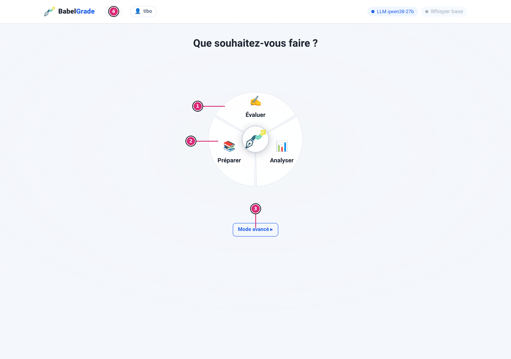

**Légende** — 1. *Évaluer* (l'action la plus utilisée) · 2. *Préparer*
(sujets, grilles, élèves) · 3. *Mode avancé* (tous les onglets classiques) ·
4. Langue et compte.

Trois **actions principales** s'offrent à vous (au clic, ou avec les flèches du
clavier + Entrée) :

- **Évaluer** (✍️) : noter la production d'un élève — le cœur de BabelGrade.
- **Préparer** (📚) : préparer vos sujets, vos grilles et votre liste d'élèves.
- **Analyser** (📊) : relancer l'IA sur une production déjà notée.

Le **Mode avancé** (3) repasse à la navigation classique par onglets
(Sujets / Évaluations / Grilles / Élèves / Tâches). Tout ce que vous verrez
ensuite se fait aussi bien depuis le menu rond que depuis les onglets.

---

## 2. Évaluer une production (avec l'IA)

L'action **Évaluer** (✍️) commence par un petit choix :

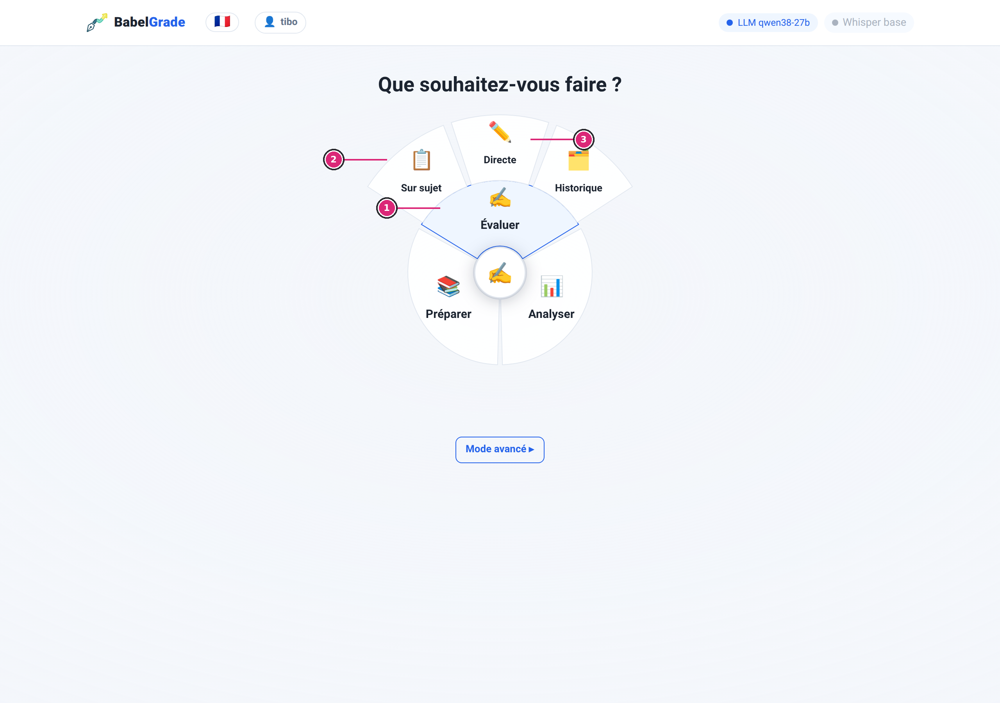

**Légende** — 1. *Évaluer* (action sélectionnée) · 2. *Sur un sujet* (évaluer
une production liée à un sujet enregistré) · 3. *Évaluation directe*
(sans sujet, à la volée).

Les deux mènent au même formulaire, **l'Évaluateur** (§3). Vous y déposez le
travail de l'élève, et le bouton principal — **✦ Analyser avec l'IA** — lance
l'analyse : l'IA propose un niveau par critère, avec des exemples cités dans la
copie, et vous corrigez ce que vous voulez. **C'est le cas d'usage normal** :
vous avez un point de départ sérieux, il reste à le valider.

> **Une autre façon est possible : « ✍️ Évaluer d'abord ».** Vous remplissez
> vous-même chaque critère, et l'IA donne ensuite un avis (en option) pour
> confirmer votre note ou vous alerter. C'est utile pour trancher a posteriori
> une hésitation, mais ce n'est pas le chemin par défaut.

Dans tous les cas, **l'IA est un conseil, jamais une décision** : votre note
fait toujours foi, et relancer l'IA n'écrase jamais les niveaux que vous avez
saisis.

---

## 3. L'Évaluateur (le formulaire)

L'Évaluateur est un formulaire en **4 blocs**, du haut vers le bas.

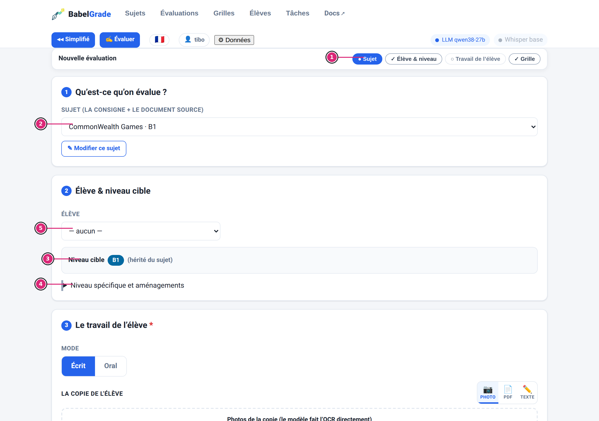

**Légende** — 1. L'indicateur des étapes déjà remplies · 2. *Sujet* (choisissez
le sujet enregistré, ou évaluez à la volée sans sujet) · 3. *Niveau cible*
hérité du sujet · 4. *Niveau spécifique et aménagements* (changer le niveau
pour cet élève, préciser les aménagements) · 5. *Élève*.

**Légende** — 1. *Travail de l'élève* : photo(s) de la copie, **PDF du
travail** (bouton 📄), ou texte collé · 2. *Grille d'évaluation* (LVA/LVB,
Bac, BTS…) · 3. **✦ Analyser avec l'IA** · 4. **✍️ Évaluer d'abord**.

Ce qu'il faut retenir :

- **Photo(s)** : plusieurs pages dans l'ordre de lecture ; l'IA les lit
  directement, pas de saisie manuelle.
- **PDF du travail** : si le PDF contient du texte, il complète le texte saisi ;
  s'il est scanné, ses pages sont lues par l'IA.
- **Le contexte du sujet** (consigne, document source, consignes d'évaluation)
  est pré-rempli quand vous choisissez un sujet.
- **La grille est le choix le plus important** : elle fixe la forme du rapport
  (attestation LVA/LVB, Bac, BTS…). Le type du sujet (compréhension/expression ×
  écrit/oral) suggère la bonne grille.
- **L'élève** : créez-le sur place s'il n'existe pas encore. Changer d'élève
  vide automatiquement son travail (photos, texte, audio).
- Sur **mobile**, « Évaluer d'abord » passe en mode **un critère à l'écran**,
  avec les 6 niveaux en gros boutons.

---

## 4. Pendant l'analyse

Une analyse écrite prend **1 à 2 minutes**, une orale **~3 minutes**
(transcription comprise). L'interface ne se bloque jamais :

- Une pastille **« Analyse IA en cours »** apparaît en haut de l'écran, avec le
  temps écoulé — c'est votre indicateur que la tâche tourne.
- Vous pouvez continuer à travailler : naviguer, préparer un autre sujet, etc.
  L'analyse se poursuit en arrière-plan.
- Quand c'est prêt, la pastille change et le rapport s'ouvre dans
  **Évaluations** (§5).

Pour suivre, relancer ou gérer plusieurs analyses à la fois, voir
**§13 Les tâches en cours**.

---

## 5. Le rapport d'évaluation

Quand l'analyse est finie, le rapport s'ouvre dans **Évaluations**.

### 5.1 Après une analyse IA

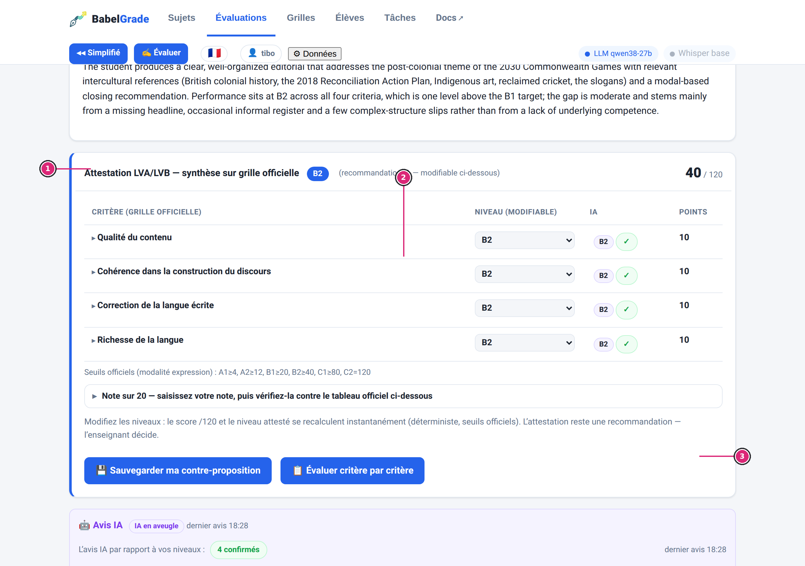

**Légende** — 1. Synthèse : niveau proposé, score /120, niveau cible ·
2. Un niveau **par critère de la grille officielle**, modifiable, avec les
points · 3. Note sur 20 (classe + voie LVA/LVB).

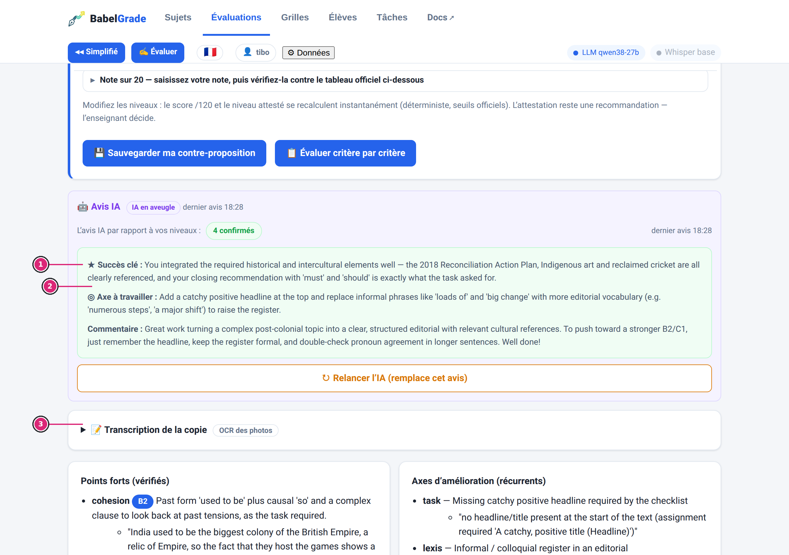

**Légende** — 1. Bannière IA : relancer l'avis (en aveugle, ou au courant de
vos niveaux) · 2. Feedback pour l'élève : points forts + axes de progression ·
3. Transcription de la copie (reconnaissance automatique, copiable).

C'est **votre lecture** qui compte : modifiez chaque niveau si vous êtes en
désaccord, le score et la note se recalculent en direct.

### 5.2 Après une évaluation enseignant (Évaluer d'abord)

**Légende** — 1. Vos niveaux saisis (modifiables) · 2. *Revoir critère par
critère* (mode Évaluation, §6) · 3. L'avis IA : où l'IA est d'accord (✓) ou
diverge (≠) · 4. Relancer l'avis IA.

### 5.3 Le rapport oral

Pour les grilles orales, le rapport ajoute la **transcription horodatée**
(corrigible via Annoter, §7) et les **indicateurs de fluence** mesurés
(mots/minute, pauses, hésitations) :

**Légende** — 1. Bannière *Analyse IA (optionnelle)* : vous avez évalué
d'abord, lancez l'IA quand vous voulez · 2. Fluence mesurée (mots/minute,
pauses, hésitations) · 3. Transcription horodatée (corrigible via Annoter).

Chaque évaluation reste modifiable ensuite : *validée par l'enseignant* est une
pastille, pas un verrou.

---

## 6. Mode Évaluation (critère par critère)

Depuis un rapport, le bouton **Revoir critère par critère** ouvre le mode
Évaluation : un critère à l'écran, les 6 niveaux à choisir.

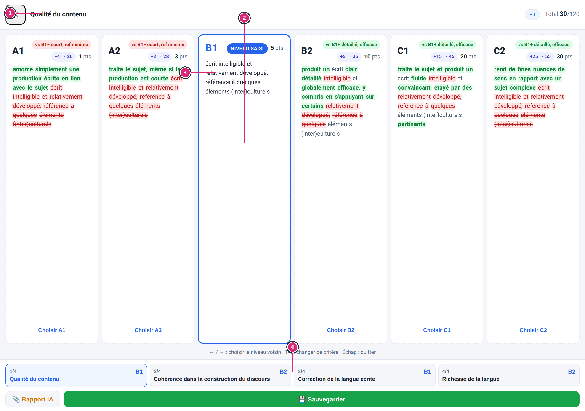

**Légende** — 1. Le critère en cours + le score total /120 · 2. Les 6 niveaux
CEFR en cartes (descripteur + points) · 3. Le descripteur du niveau choisi ·
4. Les autres critères, en bas.

- **Clavier** : `←`/`→` pour changer de niveau · `1–4` pour changer de
  critère · `Échap` pour quitter (une barre vous protège si un niveau reste à
  saisir).
- Le score total se met à jour à chaque choix.
- **Mobile (portrait)** : un critère plein écran, les 6 niveaux en grille de
  gros boutons.

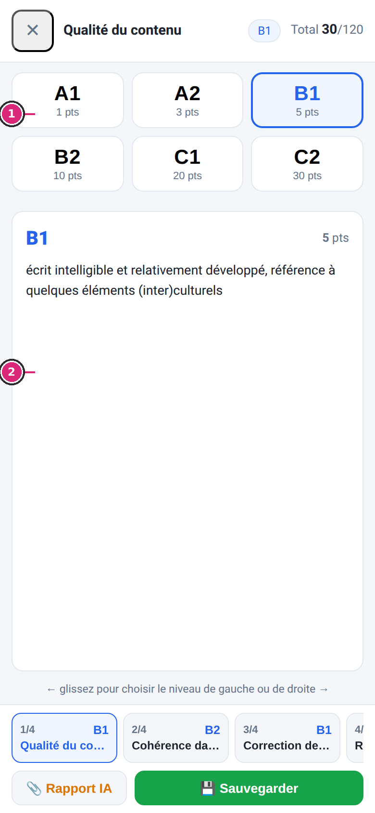

**Légende** — 1. Grille des niveaux (un critère à la fois) · 2. Descripteur du
niveau choisi.

---

## 7. Annoter (marquer la copie)

Depuis un rapport, l'icône **✏️ Annoter** ouvre la copie en deux panneaux : la
photo à gauche, vos repères à droite. Sélectionnez un passage, attachez-lui un
niveau estimé et une note — il restera relié à sa place exacte dans la photo.

**Légende** — 1. Photo de la copie : les lignes détectées sont cliquables, la
sélection surligne le passage · 2. Panneau d'annotation : niveau estimé + note
+ icônes (👍 👎 ⭐…) · 3. **Enregistrer** le repère.

- Vos repères alimentent l'IA au prochain re-lancement — elle les cite.
- La transcription de la copie se lance **automatiquement** après l'analyse IA
  (carte « Transcription de la copie »).
- Pour l'oral : lecture audio synchronisée + transcription corrigible.

---

## 8. Sujets

Un **sujet** regroupe, pour une séance de classe : la consigne, le document
source (texte, PDF, audio ou photos), les consignes d'évaluation et le niveau
cible.

**Légende** — 1. *Nouveau sujet* · 2. Type d'exercice (compréhension/expression
× écrit/oral) · 3. Ressources jointes · 4. Actions : 📊 stats · 👁 détails ·
▶ utiliser dans l'Évaluateur · ✎ modifier · ✕ supprimer.

- **Le type d'exercice choisit la grille** : quand vous sélectionnez le sujet
  dans l'Évaluateur, le canal (écrit/oral) et la grille LVA/LVB correspondante
  sont proposés d'office.
- Un sujet se crée aussi **directement depuis l'Évaluateur** (bouton 💾) —
  pratique quand vous évaluez d'abord et formalisez le sujet ensuite.
- Le **📊** ouvre les résultats du sujet (§11.2).

---

## 9. Élèves

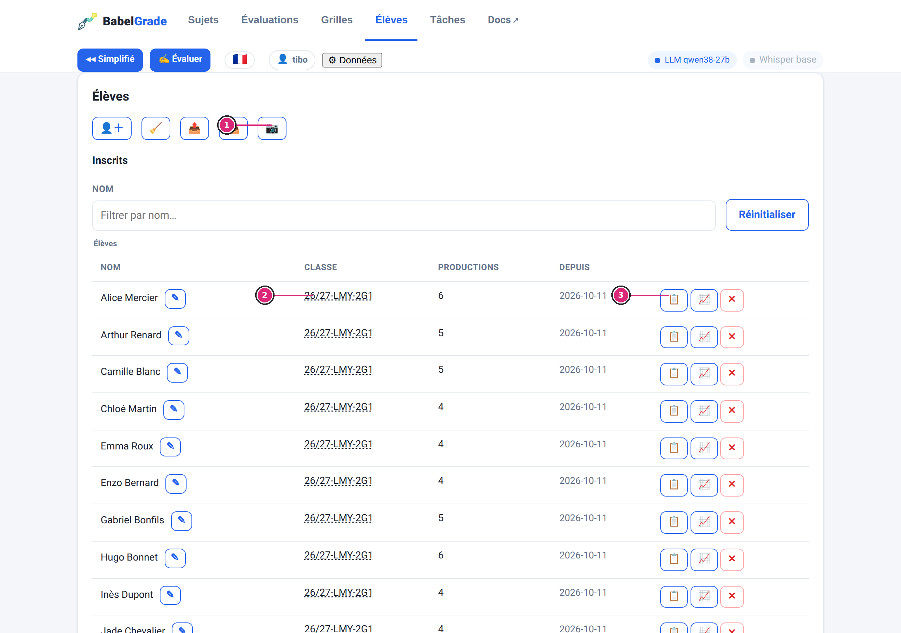

**Légende** — 1. *Importer la classe* depuis une photo de la liste des élèves ·
2. Code de classe (suggéré : `AAAA/AA-COLE-CLASSE`, ex. `26/27-LMY-2G1`) ·
3. Actions par élève : 📋 historique · 📈 évolution · ✕ retirer.

- L'élève se crée aussi **à la volée** dans l'Évaluateur.
- Le **code de classe** sert à purger une classe d'un clic (panneau *Purger*)
  et à ranger la liste.
- Chaque élève a son **historique** (📋) et son **évolution** (📈, §11.1).

---

## 10. Grilles

Les grilles sont **pré-configurées** (en lecture seule) :

- **Attestation LVA/LVB officielle** : compréhension (écrit & oral), expression
  écrite, expression orale — notée /120, avec conversion en /20 par classe et
  voie.
- **Bac** (écrit / oral) et **BTS** (écrit / oral), plus des grilles génériques
  CEFR.

C'est le choix de grille qui fixe le nombre de critères, la colonne IA et les
seuils de note /20.

---

## 11. Statistiques

### 11.1 L'évolution d'un élève (📈)

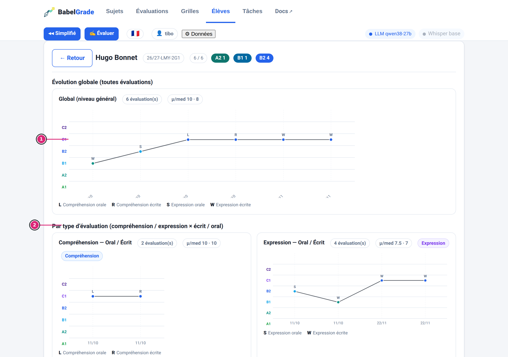

**Légende** — 1. Évolution des niveaux dans le temps (écrit/oral ×
compréhension/expression) · 2. Détail par type d'évaluation.

### 11.2 Les résultats d'un sujet (📊)

Depuis la liste des sujets, le bouton **📊** (visible dès que le sujet a
au moins 3 productions) ouvre l'analyse de la classe :

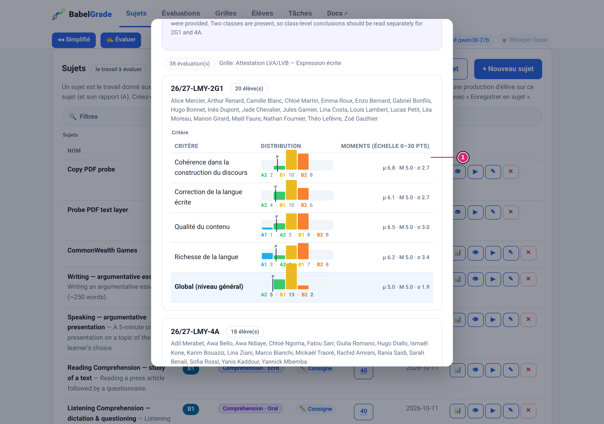

**Légende** — 1. Distribution des niveaux **par classe** : un nuage par
critère, avec la moyenne (μ), la médiane et l'écart-type (σ).

En option, un **avis IA de classe** (relançable) résume le niveau de la classe,
son hétérogénéité et ce qui a fonctionné ou non.

---

## 12. Astuces & dépannage

**Astuces**

- **L'IA conseille, vous décidez** : votre note fait foi ; relancer l'IA ne
  modifie jamais les niveaux que vous avez saisis.
- **Une divergence n'est pas une erreur** : l'IA peut être plus généreuse sur
  la dimension communication — lisez sa justification avant de trancher.
- **Un audio long** : la transcription peut prendre le temps de s'écouler ;
  suivez la tâche dans l'onglet *Tâches* (§13) plutôt que d'attendre.
- **Mobile** : sous 760 px, le rapport passe en cartes empilées ; le mode
  critère-par-critère a son mode portrait dédié (§6).
- **Langue** : ce que produit l'IA suit la langue de l'interface.

**Dépannage**

| Symptôme | Piste |
|---|---|
| « Tâche en erreur » | Le message est dans l'onglet *Tâches* (§13) ; souvent l'IA indisponible ou un audio illisible. |
| Rapport « squelette » figé | L'évaluation n'a pas abouti — relancez-la. |
| Colonne IA vide | Vérifiez dans *Tâches* que la tâche n'est ni annulée ni en erreur. |
| Lenteur globale | Baissez le nombre de tâches simultanées à 1. |
| Photos dans le mauvais sens | L'orientation est corrigée automatiquement ; si une copie reste tordue, signalez-la avec le nom du fichier. |

---

## 13. Les tâches en cours (file de traitement)

Si vous lancez plusieurs analyses à la fois, ou si vous voulez voir ce qui
tourne en arrière-plan, l'onglet **Tâches** (visible dans le *Mode avancé*) est
le lieu de contrôle.

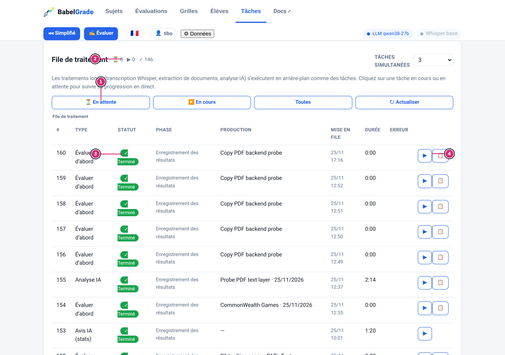

**Légende** — 1. Filtres (En attente / En cours / Toutes) · 2. Compteurs en
direct · 3. Phase et durée de chaque tâche · 4. *Suivre* une tâche en direct
(le texte du modèle défile).

À retenir :

- Les traitements (transcription Whisper, lecture des photos, analyse IA)
  tournent **en arrière-plan** : l'interface ne se bloque jamais.
- **1 à 4 tâches simultanées** : le nombre de traitements en parallèle.
- Si le serveur redémarre, les tâches interrompues sont **remises en file
  automatiquement** — rien ne se perd.
- Une tâche en erreur : le message s'affiche ici même ; c'est souvent l'IA qui
  est indisponible, ou un audio illisible.

*Documentation technique (architecture, file de tâches, README) : dans la
navigation du site, onglets « Architecture », « Async jobs », « README ».*
