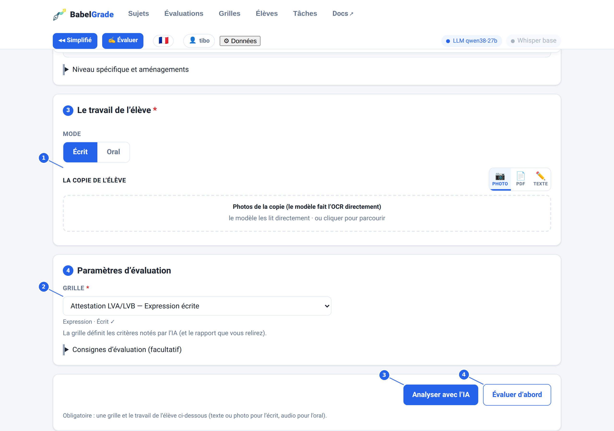
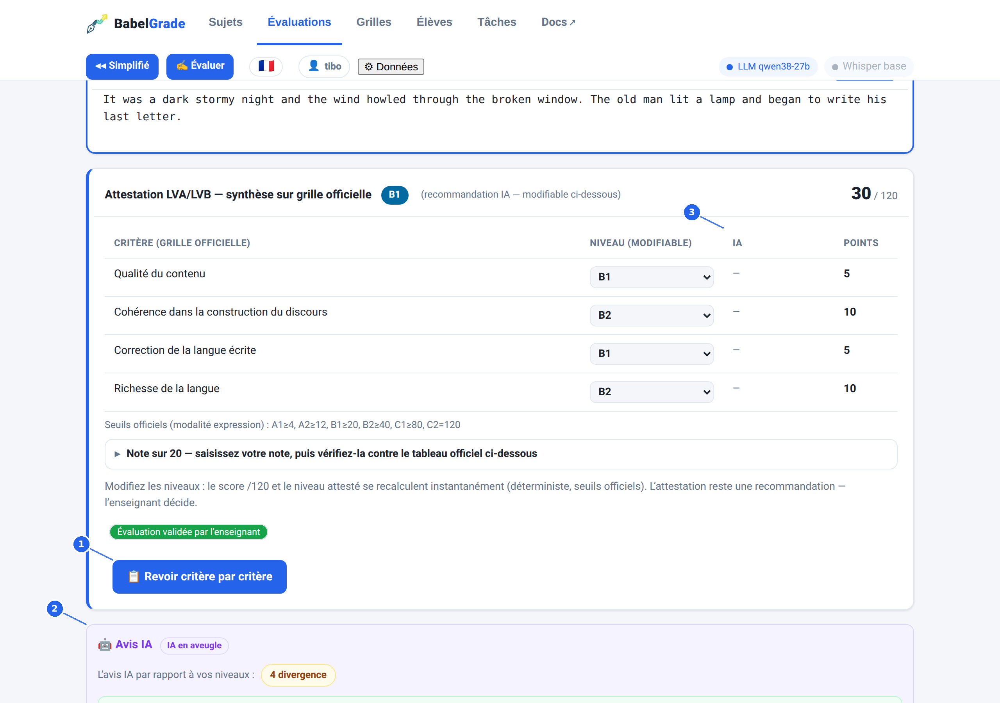
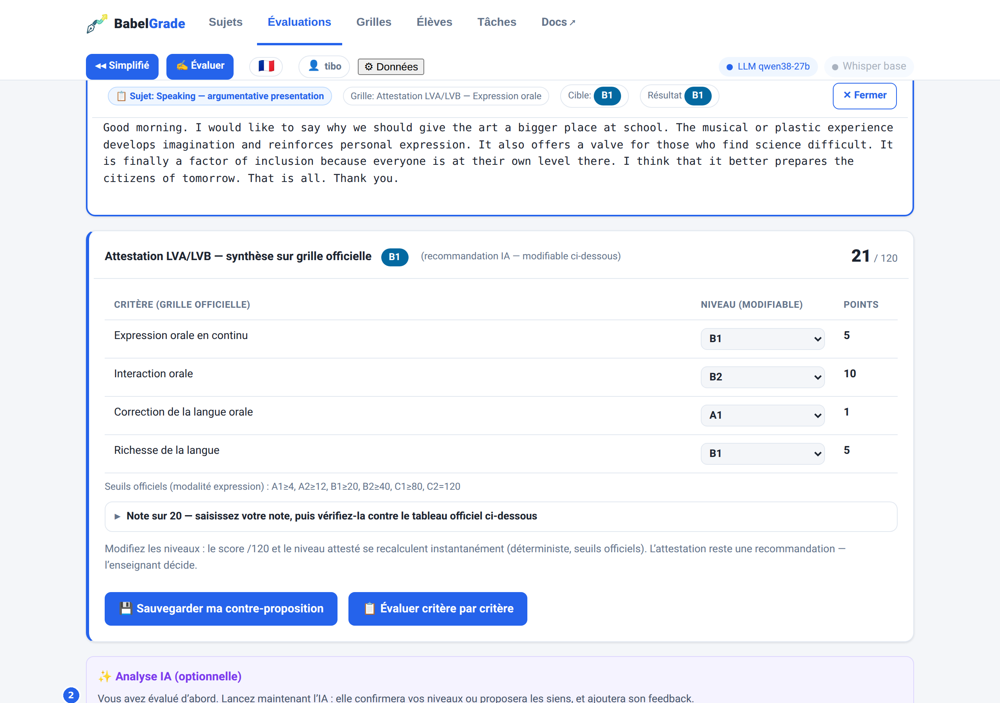
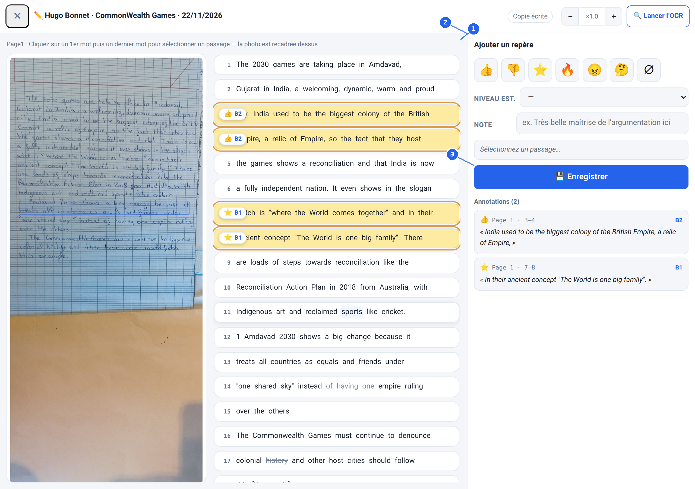
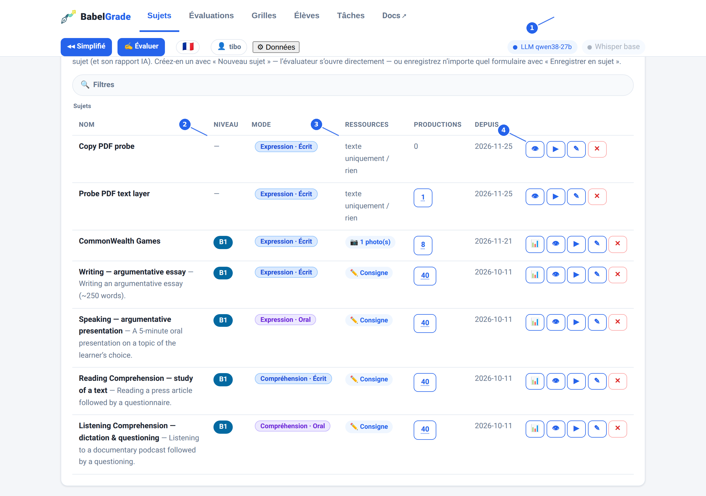

# Guide utilisateur — BabelGrade

> Guide de l'enseignant : évaluer des productions écrites/orales selon le CEFR
> (grilles LVA/LVB /120 et Bac/BTS), avec l'aide optionnelle de l'IA.
> L'interface est disponible en **français, anglais, espagnol et allemand**
> (sélecteur en haut à droite, drapeau 🇫🇷).
>
> **Chaque capture ci-dessous est annotée de badges numérotés ; la légende se
> lit juste sous l'image.**

---

## 1. Premiers pas

BabelGrade tourne en local sur votre machine : vous vous connectez avec vos
identifiants, puis tout se passe dans l'application web (navigateur).

Au démarrage, vous arrivez sur l'**accueil** : un **menu radial** qui vous
demande « Que souhaitez-vous faire ? ».

**Légende** — 1. Verbe *Évaluer* (le plus courant) · 2. Verbe *Préparer*
(sujets, grilles, élèves) · 3. *Mode avancé* (tous les onglets classiques) ·
4. Langue et compte.

- Choisissez un **verbe** (clic ou flèches clavier + Entrée) pour ouvrir
  l'écran correspondant.
- **Mode avancé** revient à l'ancienne navigation par onglets
  (Sujets / Évaluations / Grilles / Élèves / Tâches).
- Tout ce qui suit peut donc se faire de deux façons : menu radial ou onglets.

---

## 2. Évaluer : les deux façons de travailler

Le verbe **Évaluer** (✍️) s'ouvre sur deux sous-modes :

**Légende** — 1. Verbe sélectionné (souche du menu) · 2. *Sur un sujet*
(évaluer une production liée à un sujet enregistré) · 3. *Évaluation directe*
(ad hoc, sans sujet).

Deux **boucles** coexistent, choisissez selon votre pratique :

| Boucle | Vous faites | L'IA fait | Quand |
|---|---|---|---|
| **A — IA d'abord** | Vous relisez et ajustez la matrice | Propose niveaux + justificatives | Vous voulez un point de départ rapide |
| **B — Évaluer d'abord** | Vous notez chaque critère vous-même | Donne un avis en option (aveugle ou au courant) | Vous voulez garder le contrôle, IA en second |

L'IA est un **conseil, jamais une décision** : la matrice de l'enseignant fait
toujours foi, un re-lancement d'IA n'écrase jamais vos niveaux.

---

## 3. L'Évaluateur (le formulaire)

L'Évaluateur est un formulaire en **4 blocs**, d'en haut en bas :

**Légende** — 1. Assistant : les points indiquent les blocs remplis ·
2. *Sujet* : choisissez le sujet enregistré (ou *ad hoc* pour une évaluation
sans sujet) · 3. *Niveau cible* hérité du sujet · 4. *Niveau spécifique et
aménagements* : forcer un niveau pour un élève et préciser les aménagements ·
5. *Élève*.

**Légende** — 1. *Travail de l'élève* : photo(s) de la copie, **PDF du
travail** (bouton 📄 — non présélectionné), ou texte collé · 2. *Grille
d'évaluation* (LVA/LVB par modalité, Bac, BTS…) · 3. *✦ IA d'abord* — lance
l'analyse IA · 4. *✍️ Évaluer d'abord* — crée le rapport « squelette » sans
attendre l'IA.

Détails utiles :

- **Photo(s)** : plusieurs pages dans l'ordre de lecture ; le modèle les lit
  directement (pas de saisie manuelle).
- **PDF du travail** : PDF tapé → sa couche texte complète le texte saisi ;
  PDF scanné → les pages sont numérisées puis lues par l'IA.
- **Contexte du sujet** (consigne, document source, consignes
  d'évaluation) est pré-rempli quand vous choisissez un sujet.
- **Grille** : c'est le choix le plus important — il détermine la structure
  du rapport (attestation LVA/LVB, Bac, BTS…). Le type du sujet
  (compréhension/expression × écrit/oral) suggère la bonne grille.
- **Élève** : s'il n'existe pas encore, créez-le sur place. Changer d'élève
  vide automatiquement le travail de l'élève (photos, texte, audio).
- Sur **mobile**, le bloc « Évaluer d'abord » passe en mode **critère par
  critère portrait** : un critère à l'écran, les 6 niveaux en gros boutons.

---

## 4. La file de traitement (Tâches)

Les traitements longs (transcription Whisper, lecture des photos, analyse IA)
tournent **en arrière-plan** : l'interface ne se bloque jamais.

**Légende** — 1. Filtres (En attente / En cours / Toutes) + compteurs en
direct · 2. Phase et durée de chaque tâche · 3. Suivre une tâche en direct
(tokens du modèle qui défilent).

- Pendant un run, une **carte de suivi** s'affiche : vous pouvez naviguer
  ailleurs, la tâche continue.
- **Tâches simultanées (1–4)** : nombre de workers ; si le serveur redémarre,
  les tâches interrompues sont **remises en file** automatiquement.
- Comptez 1–2 min pour une analyse écrite, ~3 min pour un oral (transcription
  Whisper comprise).

---

## 5. Le rapport d'évaluation

Quand la tâche est finie, le rapport s'ouvre dans **Évaluations**.

### 5.1 Après une analyse IA (boucle A)

**Légende** — 1. En-tête : grille, niveau cible, niveau proposé par l'IA,
score /120 · 2. Un niveau **par critère de la grille officielle**, modifiable
par l'enseignant + points · 3. Note sur 20 (conversion, classe + voie
LVA/LVB) · 4. Bannière IA : relancer l'avis (en aveugle ou au courant).

**Légende** — 1. Feedback pour l'élève : succès clés + axes de progression ·
2. Transcription de la copie (OCR automatique, copiable) · 3. Actions :
**Annoter**, copier le texte, imprimer, télécharger le rapport.

### 5.2 Après une évaluation enseignant (boucle B)

**Légende** — 1. Vos niveaux saisis (colonne IA : `✓` = l'IA est d'accord,
`≠` = divergence à trancher) · 2. *Revoir critère par critère* (mode
Évaluation) · 3. Avis IA (en aveugle) + résumé confirmés / divergences.

Le **score /120 et le niveau attesté se recalculent en direct** quand vous
changez un niveau. Chaque évaluation reste modifiable ensuite ;
*validée par l'enseignant* est une pastille, pas un verrou.

### 5.3 Le rapport oral

Pour les grilles orales, le rapport ajoute la **transcription horodatée**
(corrigible via Annoter) et les indicateurs de fluence mesurés (WPM, pauses,
hésitations) :

**Légende** — 1. Transcription de l'oral · 2. Bannière *Analyse IA
(optionnelle)* : vous avez évalué d'abord, lancez l'IA quand vous voulez ·
3. Feedback pour l'élève.

---

## 6. Mode Évaluation (critère par critère)

Depuis un rapport « Évaluer d'abord », le bouton **Revoir critère par
critère** (ou le bloc 4 de l'Évaluateur) ouvre le mode Évaluation :

**Légende** — 1. Le critère courant + le score total /120 · 2. Les 6 niveaux
CEFR en cartes (descripteur + fourchette de points) · 3. Le descripteur du
niveau choisi · 4. Les autres critères en onglets en bas.

- **Clavier** : `←`/`→` changer de niveau · `1–4` changer de critère ·
  `Échap` quitter (avec barre de garde si le formulaire est vide).
- Le score total se met à jour à chaque choix.
- **Mobile portrait** : un critère plein écran, les 6 niveaux en grille de
  gros boutons tapables.

**Légende** — 1. Grille des 6 niveaux (un critère à la fois) · 2. Descripteur
du niveau choisi.

---

## 7. Annoter (marquer la copie)

Depuis le rapport (icône ✏️ **Annoter**), vous pouvez **marquer la copie** :
sélectionner un passage, lui attacher un niveau estimé + une note, et le
rattacher à la photo de la copie.

**Légende** — 1. Photo de la copie : les lignes OCR sont cliquables, la
sélection surligne le passage · 2. Panneau d'annotation : niveau estimé +
note libre + icônes (👍 👎 ⭐ 🔥…) · 3. *Enregistrer* le repère.

- Les repères alimentent le contexte IA au prochain re-lancement
  (`TEACHER'S PRE-ANNOTATIONS`) — l'IA les cite.
- L'OCR de la copie se lance **automatiquement** après l'analyse IA
  (carte « Transcription de la copie ») ; Annoter suit l'OCR en cours.
- Pour l'oral : panneau audio synchronisé + transcription corrigible.

---

## 8. Sujets

Un **sujet** regroupe la consigne, le document source (texte, PDF, audio ou
photos), les consignes d'évaluation et le niveau cible d'une tâche de classe.

**Légende** — 1. *Nouveau sujet* · 2. Le type d'exercice (compréhension /
expression × écrit / oral) · 3. Les ressources jointes · 4. Actions : 📊 stats
d'analyse · 👁 détails · ▶ utiliser dans l'évaluateur · ✎ modifier · ✕
supprimer.

- Le **type d'exercice pilote la grille** : quand vous choisissez le sujet
  dans l'Évaluateur, le canal (écrit/oral) est pré-coché et la grille
  LVA/LVB correspondante est suggérée.
- Un sujet se crée aussi **depuis l'Évaluateur** (bouton 💾) — pratique quand
  vous évaluez d'abord et formalisez ensuite.
- Le bouton **📊** ouvre l'analyse des résultats du sujet (voir §11).

---

## 9. Élèves

**Légende** — 1. *Importer la classe* depuis une photo de la liste (roster) ·
2. Code de classe (suggéré : `AAAA/AA-COLE-CLASSE`, ex. `26/27-LMY-2G1`) ·
3. Actions par élève : 📋 historique · 📈 stats · ✕ retirer.

- L'élève se crée aussi à la volée dans l'Évaluateur.
- Le **code de classe** sert au purge par préfixe (panneau Purger) et
  organise la liste.
- Chaque élève a un **historique** (📋) et une **stat d'évolution** (📈).

---

## 10. Grilles

Les grilles sont **pré-configurées côté serveur** (lecture seule) :

- **Attestation LVA/LVB officielle** : compréhension (écrit & oral),
  expression écrite, expression orale — /120, note /20 par classe + voie.
- **Bac** (écrit / oral) et **BTS** (écrit / oral), et grilles génériques CEFR.

Le choix de grille détermine : nombre de critères, colonne IA, attestation
/120 et seuils de note /20.

---

## 11. Statistiques

### 11.1 Évolution d'un élève (📈)

**Légende** — 1. Évolution des niveaux dans le temps (écrit/oral ×
compréhension/expression) · 2. Détail par évaluation.

### 11.2 Résultats d'un sujet (📊)

Depuis la liste des sujets, le bouton **📊** (visible dès que le sujet a ≥ 3
productions) ouvre l'analyse de classe :

**Légende** — 1. Distribution des niveaux **par classe** : histogramme par
critère + moyenne (μ), médiane (M) et écart-type (σ).

En option, l'**Avis IA de classe** (relançable) synthétise niveau de la
classe, hétérogénéité, ce qui a bien fonctionné et ce qui a posé problème.

---

## 12. Astuces & dépannage

**Astuces**

- **L'IA est un conseil, pas une décision** : la matrice d'enseignant fait
  foi ; un re-lancement d'IA ne modifie jamais vos niveaux.
- **Divergence ≠ erreur** : l'IA peut être plus généreuse sur la dimension
  communication — lisez la justification avant de trancher.
- **Audio long** : la transcription Whisper peut durer ; suivez la tâche dans
  l'onglet *Tâches* plutôt que de patienter.
- **Mobile** : sous 760 px, le rapport passe en cartes empilées ; le mode
  critique-par-critère a son mode portrait dédié (voir §6).
- **Langue** : le contenu produit par l'IA suit la langue de l'interface.

**Dépannage**

| Symptôme | Piste |
|---|---|
| « Tâche en erreur » | Message `error` dans l'onglet *Tâches* ; souvent LLM indisponible ou audio illisible. |
| Rapport « squelette » figé | Le job `evaluate` a échoué avant persistance — relancez l'évaluation. |
| Colonne IA vide après un run-ai | La bannière doit être en état *done* avec résumé ; sinon vérifiez les *Tâches* (job annulé / erreur). |
| Lenteur globale | Réduisez **Tâches simultanées** à 1 (le modèle LLM local tourne en mono-mécanique). |
| Photos dans le mauvais sens | L'orientation est normalisée automatiquement (EXIF + dé-rotation) ; si une copie reste tordue, signalez-la avec le nom du fichier. |

*Documentation développeurs : architecture, file de jobs asynchrones, README
technique — dans la navigation du site (onglets « Architecture »,
« Async jobs », « README »).*
